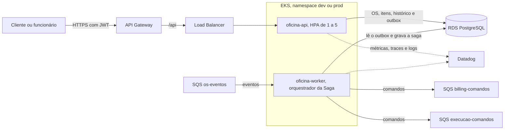
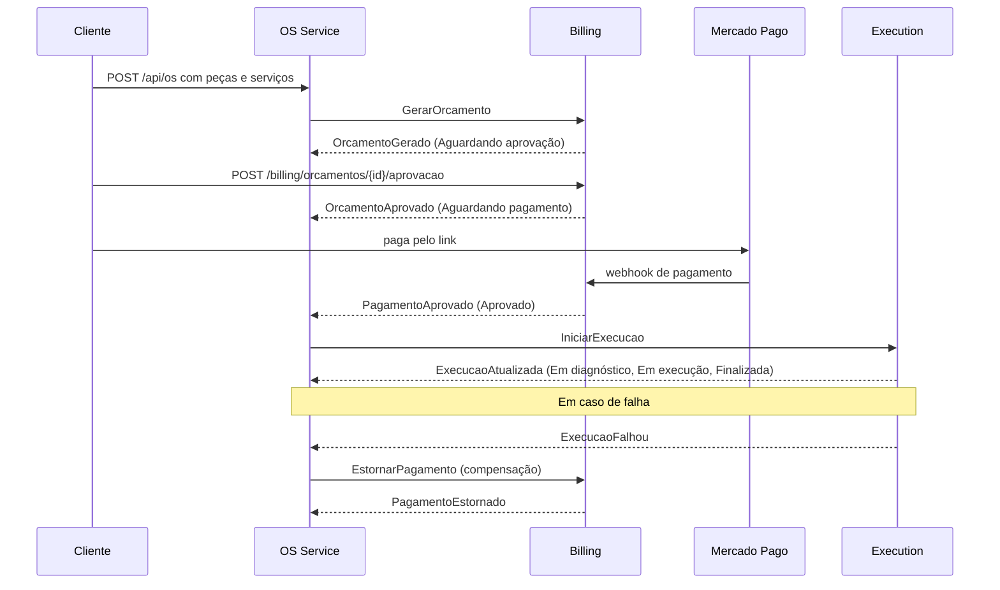

# fiap_tech_challenge_oficina_api (OS Service)

Microsserviço de ordens de serviço da oficina: cadastros (clientes, veículos, catálogo de peças e serviços), abertura da OS, status, histórico e orquestração da Saga. Roda no EKS, atrás do API Gateway, e grava no RDS PostgreSQL. Faz parte do Tech Challenge Fase 4:

| Repositório | Responsabilidade |
|---|---|
| fiap_tech_challenge_oficina_api | Este repositório. OS Service, orquestrador da Saga |
| [fiap_tech_challenge_oficina_billing_service](https://github.com/gabrielov2003/fiap_tech_challenge_oficina_billing_service) | Orçamentos e pagamentos com Mercado Pago |
| [fiap_tech_challenge_oficina_execution_service](https://github.com/gabrielov2003/fiap_tech_challenge_oficina_execution_service) | Fila de execução, diagnóstico e reparo |
| [fiap_tech_challenge_oficina_auth_lambda](https://github.com/gabrielov2003/fiap_tech_challenge_oficina_auth_lambda) | Autenticação por CPF e API Gateway |
| [fiap_tech_challenge_oficina_infra_k8s](https://github.com/gabrielov2003/fiap_tech_challenge_oficina_infra_k8s) | Rede, cluster EKS, registro de imagens, segredos e Datadog |
| [fiap_tech_challenge_oficina_infra_database](https://github.com/gabrielov2003/fiap_tech_challenge_oficina_infra_database) | Banco RDS PostgreSQL do OS Service |

## Arquitetura



O código segue DDD com arquitetura hexagonal:

| Arquivo | Papel |
|---|---|
| `src/domain.py` | Entidades, validação de CPF, CNPJ e placa, e transições da OS |
| `src/ports.py` | Interfaces de repositórios, mensageria, saúde do banco e métricas |
| `src/application.py` | Casos de uso e a Saga (`SagaOrdemServico`) |
| `src/infrastructure.py` | Repositórios PostgreSQL, outbox, SQS e métricas do Datadog |
| `src/web.py` | Rotas, controle de acesso por perfil e Swagger |
| `src/worker.py` | Processo que publica o outbox e consome os eventos da Saga |
| `src/observabilidade.py` | Logs JSON e correlation id |
| `src/app.py` | Monta a aplicação e injeta os adapters |

## Saga: orquestrada

A Saga da OS é orquestrada por este serviço. Escolhemos orquestração em vez de coreografia porque o OS Service já é dono da máquina de estados da OS: ele decide o próximo passo, guarda o estado da saga no próprio status da OS e no histórico, e concentra as compensações num lugar só. Isso deixa o fluxo fácil de seguir nos logs e no Datadog e fácil de testar. Na coreografia, cada serviço reagiria aos eventos dos outros e o fluxo ficaria espalhado em três repositórios.



| Etapa | Sucesso | Falha e compensação |
|---|---|---|
| Abertura | OS Recebida e comando `GerarOrcamento` | Dados inválidos: a saga nem começa |
| Orçamento | `OrcamentoGerado`, OS Aguardando aprovação | `OrcamentoFalhou`: OS Cancelada |
| Aprovação | `OrcamentoAprovado`, OS Aguardando pagamento | `OrcamentoRecusado`: OS Recusada |
| Pagamento | `PagamentoAprovado`, OS Aprovado e comando `IniciarExecucao` | `PagamentoRecusado`: OS Cancelada, o Billing cancela a cobrança |
| Execução | `ExecucaoAtualizada` até Finalizada | `ExecucaoFalhou`: OS Cancelada e comando `EstornarPagamento` para o Billing |
| Entrega | Funcionário marca Entregue | |

Como a consistência é garantida:

* Outbox: o comando é gravado na tabela `outbox` na mesma transação da OS. O worker publica depois no SQS, então nunca acontece de gravar a OS e perder o comando.
* Filas FIFO com `MessageGroupId` igual ao id da OS: os eventos de uma OS chegam em ordem.
* Idempotência: evento repetido ou fora de ordem é ignorado pela máquina de estados, e a mudança de status só grava se o status lido ainda for o atual.
* Erro inesperado deixa a mensagem na fila para nova tentativa, e depois de 3 tentativas ela vai para a DLQ.

## Autenticação e perfis

| Perfil | Como obtém o token | O que acessa |
|---|---|---|
| `admin` (funcionário) | `POST /api/login` com usuário e senha | Todas as rotas |
| `cliente` | `POST /auth` no API Gateway, com o CPF | Abrir OS para si e listar as próprias OS |
| `servico` | Gerado pela Lambda de autenticação | Só `GET /api/clientes/documento/{cpf}`, para validar o cliente no login |

Rotas públicas: `GET /api/os/{id}`, `GET /api/os/{id}/status`, `GET /api/health` e `GET /api/ready`. O status da OS é controlado pela Saga, e manualmente o funcionário só marca `Entregue`.

A senha do `admin` vem do secret `ADMIN_PASSWORD` do GitHub. Sem ele, o pipeline usa a senha gerada pelo Terraform em `/oficina/<env>/admin_password`, no SSM.

## Swagger

* Nuvem: `<URL do gateway>/apidocs/`, com a barra no final.
* Local: `http://localhost:5000/apidocs/`.

## Banco de dados

PostgreSQL no RDS, schema por ambiente (`dev` ou `prod`). As tabelas, incluindo a `outbox`, são criadas pela API na inicialização, dentro de um advisory lock. A justificativa do banco e o diagrama ER estão no [README do infra_database](https://github.com/gabrielov2003/fiap_tech_challenge_oficina_infra_database). Nenhum outro serviço acessa esse banco.

## Observabilidade

* Logs JSON com `correlation_id`, `id_os` e `dd.trace_id`. Filtrar por `@id_os` no Datadog mostra a saga inteira nos três serviços.
* APM com `ddtrace-run` na API e no worker, incluindo as chamadas ao SQS.
* Healthcheck em `/api/health` e `/api/ready`.
* Métricas: `oficina.os.abertas`, `oficina.os.status_alterado`, `oficina.os.tempo_status`, `oficina.os.falhas`, `oficina.saga.eventos` (tags `tipo` e `resultado`) e `oficina.integracao.erros`.

## Como rodar localmente

```bash
cp .env.example .env
docker compose up --build
```

A API sobe em `http://localhost:5000`. Login: `POST /api/login` com `{"username": "admin", "senha": "admin123"}`. O worker precisa das filas do SQS: com credenciais AWS e as filas do ambiente `dev` criadas, rode `python src/worker.py`.

## Testes e cobertura

```bash
docker compose up -d db
python -m pip install -r requirements.txt -r requirements-dev.txt
python -m pytest --cov --cov-report=term-missing --cov-fail-under=80
```

* Testes unitários em `tests/unit_tests.py`: cadastros, permissões, Saga, outbox, worker e adapter do SQS (com moto).
* BDD em `tests/features/saga_ordem_servico.feature`: o fluxo completo da OS e as compensações (orçamento recusado, pagamento recusado e falha na execução).
* Cobertura mínima de 80%, verificada no pipeline. O resultado de cada execução fica no resumo do job `test`, na aba [Actions](https://github.com/gabrielov2003/fiap_tech_challenge_oficina_api/actions). Última medição: 91%.

## Kubernetes

| Arquivo | O que cria |
|---|---|
| `namespace.yaml` | Namespace do ambiente |
| `serviceaccount.yaml` | Conta do worker, ligada ao role da AWS pelo Pod Identity |
| `configmap.yaml` | Conexão com o banco, schema e nomes das filas |
| `secret.yaml` | Senha do banco, chave JWT e senha do admin |
| `deployment.yaml` | API com probes, limites e tags do Datadog |
| `worker.yaml` | Worker da Saga |
| `service.yaml` | LoadBalancer usado pelo API Gateway |
| `hpa.yaml` | Escala de 1 a 5 pods por CPU (70%) ou memória (80%) |

## CI/CD

| Job | Quando roda | O que faz |
|---|---|---|
| `test` | Pull requests e pushes em `dev` e `main` | Testes unitários e BDD com PostgreSQL de serviço e cobertura mínima de 80% |
| `quality` | Junto com o `test` | Ruff (erros e complexidade), Bandit (segurança) e `terraform validate` |
| `build` | Push em `dev` ou `main` | Build da imagem e push no ECR `oficina-api` |
| `deploy` | Depois do build | Terraform da fila e do role do worker, manifestos no namespace do ambiente e URL publicada em `/oficina/<env>/api_url` |

`dev` publica no ambiente de homologação e `main` em produção. Secrets: `AWS_ACCESS_KEY_ID`, `AWS_SECRET_ACCESS_KEY` e, opcional, `ADMIN_PASSWORD`. Variáveis: `TF_STATE_BUCKET` e, opcional, `AWS_REGION`.

Ordem do primeiro deploy: `infra_k8s`, `infra_database`, este serviço, `billing_service`, `execution_service` e por último a `auth_lambda`.

---
Este projeto faz parte do Tech Challenge da Pós Graduação em Arquitetura de Software da FIAP.
